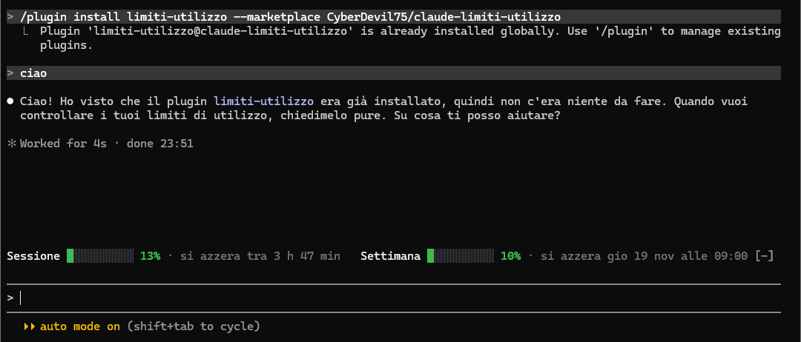
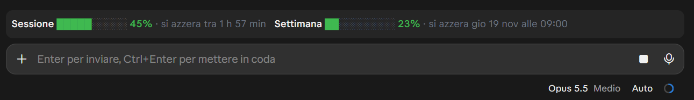

# claude-usage-limits-bar

🇬🇧 **English** · 🇮🇹 [Italiano](#-italiano)

---

## 🇬🇧 English

A mod for **Claude Code** that keeps your **Claude subscription usage limits** always in view, in a compact band right above the prompt — similar to the usage indicator in other AI chat apps.

```
Session ██░░░░░░░░ 23.5% · resets in 2 h 14 min   Week █████████░ 87% · resets Mon 23 Nov at 09:00
```



*The band in a real Claude Code terminal session, right above the prompt; `[-]` collapses it. (These screenshots come from an Italian setup, so the texts are in Italian.)*



*The same band in the Claude desktop app (local session), above the prompt box.*

### Language

The texts follow **your language**: **Italian** if you use Claude Code in Italian, **English** for every other language. More languages may come later.

The mod picks the language in this order:

1. the mod's own `lingua` option, when set to `it` or `en`;
2. Claude Code's **language** setting, when you set one;
3. your operating system's language;
4. English, when none of these can be read.

### What it shows

| Part | Meaning |
| --- | --- |
| **Session** | The **5-hour session limit** (`five_hour` window): percent used and how long until it resets (`2 h 14 min`). |
| **Week** | The **weekly limit** (`seven_day` window): percent used and the day and time it resets. |
| **Bar** | 10 blocks, filled in proportion to the percentage. |
| **Colour** | 🟢 green below 50% · 🟡 yellow from 50% to 79% · 🔴 red from 80%. |

Any other window the API reports (for example a gateway's `spend_limit`) is listed by the `/usage-limits` command.

### Where the numbers come from

These are **real figures, not estimates**. Every response from the Claude API carries the account's rate-limit windows, and Claude Code exposes them to mods through `$.session.usage()` and the `session.measure` event. They are the same numbers shown on **claude.ai → Settings → Usage**.

- The band updates when a window moves by a whole percentage point; the countdown is redrawn every minute.
- **Before the first model response** of a session there is no reading yet: the band says *"Limits: waiting for the first response"* with a link to the Usage page.
- **Subscription only.** With an API key (pay-as-you-go) the API reports no such windows, so the band only shows the link.

### Extra features

- **`/usage-limits`** slash command (`/utilizzo` in Italian): prints a detailed summary (both windows, any other window, time of the reading) and the link `https://claude.ai/settings/usage`.
- **`leggi_limiti` tool**: Claude itself can read your limits when you ask *"how much have I used?"*. It is read-only and only reads the figures above.

### Privacy

The mod sends nothing anywhere: no network calls, no files written, no telemetry. It only reads the figures Claude Code already has and draws them on screen.

### Install

At the prompt of a terminal session:

```
/plugin install usage-limits-bar --marketplace CyberDevil75/claude-usage-limits-bar
```

Answer `y` to add the marketplace, then pick a scope (the **user** scope makes it load in every session).

From a shell:

```bash
claude plugin install usage-limits-bar --marketplace CyberDevil75/claude-usage-limits-bar
```

In the desktop app, where `/plugin` does not run: click **+** next to the prompt box, then **Plugins**, **Add marketplace** with `CyberDevil75/claude-usage-limits-bar`, then **Add plugin**.

### Options

| Option | Default | Meaning |
| --- | --- | --- |
| `lingua` (language) | `auto` | `auto` = Italian for Italian users, English for everyone else; `it` = always Italian; `en` = always English. |
| `fuso_orario` (time zone) | empty | IANA time zone used for the weekly reset date, e.g. `Europe/Rome`. Empty uses the computer's own time zone. |

Change them from the plugin's config menu, or in settings under `pluginConfigs`.

### Files

| File | Purpose |
| --- | --- |
| `.claude-plugin/plugin.json` | Manifest: name, version, options. |
| `.claude-plugin/marketplace.json` | Makes this repository an installable marketplace. |
| `hooks/hooks.json` | Points Claude Code at the hooks module. |
| `hooks/register.tsx` | The mod: reads the limits, picks the language, draws the band, the slash command, `leggi_limiti`. |
| `hooks/testi.ts` | All interface texts, Italian and English: the place to add a language. |
| `hooks/limiti.test.tsx` | Render tests (`claude plugin test .`). |
| `types/index.d.ts` | Type contract of the values the mod keeps in session state. |

License: **public domain** ([The Unlicense](https://unlicense.org)). Free for everyone, for any use, no attribution required.

---

## 🇮🇹 Italiano

Una mod per **Claude Code** che tiene **sempre in vista i limiti di utilizzo del tuo abbonamento Claude**, in una riga compatta subito sopra il prompt, un po' come l'indicatore di utilizzo di altre app di chat AI.

```
Sessione ██░░░░░░░░ 23.5% · si azzera tra 2 h 14 min   Settimana █████████░ 87% · si azzera lun 23 nov alle 09:00
```


*La riga in una vera sessione di Claude Code nel terminale, subito sopra il prompt; `[-]` la chiude.*


*La stessa riga nell'app desktop di Claude (sessione locale), sopra la casella del prompt.*

### Lingua

I testi seguono **la tua lingua**: **italiano** se usi Claude Code in italiano, **inglese** per tutte le altre lingue. Altre lingue potranno arrivare in futuro.

La mod sceglie la lingua in questo ordine:

1. l'opzione `lingua` della mod, se impostata su `it` o `en`;
2. l'impostazione di **lingua** di Claude Code, se l'hai impostata;
3. la lingua del sistema operativo;
4. l'inglese, se nessuna di queste si può leggere.

### Cosa mostra

| Parte | Significato |
| --- | --- |
| **Sessione** | Il **limite di sessione di 5 ore** (finestra `five_hour`): percentuale usata e quanto manca all'azzeramento (`2 h 14 min`). |
| **Settimana** | Il **limite settimanale** (finestra `seven_day`): percentuale usata, giorno e ora dell'azzeramento. |
| **Barra** | 10 blocchi, riempiti in proporzione alla percentuale. |
| **Colore** | 🟢 verde sotto il 50% · 🟡 giallo dal 50 al 79% · 🔴 rosso dall'80%. |

Qualsiasi altra finestra riportata dall'API (per esempio lo `spend_limit` di un gateway) compare nel comando `/utilizzo`.

### Da dove arrivano i numeri

Sono **dati reali, non stime**. Ogni risposta dell'API di Claude porta con sé le finestre di limite dell'account, e Claude Code le rende disponibili alle mod tramite `$.session.usage()` e l'evento `session.measure`. Sono gli stessi numeri della pagina **claude.ai → Impostazioni → Utilizzo**.

- La riga si aggiorna quando una finestra si sposta di un punto percentuale intero; il conto alla rovescia viene ridisegnato ogni minuto.
- **Prima della prima risposta del modello** in una sessione non c'è ancora una lettura: la riga dice *"Limiti: in attesa della prima risposta"* con un link alla pagina Utilizzo.
- **Solo con abbonamento.** Con una chiave API (a consumo) l'API non riporta queste finestre, quindi la riga mostra solo il link.

### Funzioni in più

- Comando **`/utilizzo`** (`/usage-limits` in inglese): stampa un riepilogo dettagliato (entrambe le finestre, eventuali altre, ora della lettura) e il link `https://claude.ai/settings/usage`.
- Strumento **`leggi_limiti`**: Claude stesso può leggere i tuoi limiti quando gli chiedi *"quanto ho consumato?"*. È in sola lettura e legge solo i valori sopra.

### Privacy

La mod non invia nulla da nessuna parte: nessuna chiamata di rete, nessun file scritto, nessuna telemetria. Legge solo i valori che Claude Code ha già e li disegna a schermo.

### Installazione

Al prompt di una sessione nel terminale:

```
/plugin install usage-limits-bar --marketplace CyberDevil75/claude-usage-limits-bar
```

Rispondi `y` per aggiungere il marketplace, poi scegli l'ambito (l'ambito **user** la fa caricare in ogni sessione).

Da una shell:

```bash
claude plugin install usage-limits-bar --marketplace CyberDevil75/claude-usage-limits-bar
```

Nell'app desktop, dove `/plugin` non funziona: clicca **+** accanto alla casella del prompt, poi **Plugins**, **Add marketplace** con `CyberDevil75/claude-usage-limits-bar`, poi **Add plugin**.

### Opzioni

| Opzione | Predefinito | Significato |
| --- | --- | --- |
| `lingua` | `auto` | `auto` = italiano per chi usa l'italiano, inglese per tutti gli altri; `it` = sempre italiano; `en` = sempre inglese. |
| `fuso_orario` | vuoto | Fuso orario IANA usato per la data di azzeramento settimanale, es. `Europe/Rome`. Vuoto usa il fuso del computer. |

Si cambiano dal menu di configurazione del plugin, o nelle impostazioni sotto `pluginConfigs`.

### File

| File | Scopo |
| --- | --- |
| `.claude-plugin/plugin.json` | Manifesto: nome, versione, opzioni. |
| `.claude-plugin/marketplace.json` | Rende questo repository un marketplace installabile. |
| `hooks/hooks.json` | Indica a Claude Code il modulo degli hook. |
| `hooks/register.tsx` | La mod: legge i limiti, sceglie la lingua, disegna la riga, il comando, `leggi_limiti`. |
| `hooks/testi.ts` | Tutti i testi dell'interfaccia, in italiano e inglese: il punto dove aggiungere una lingua. |
| `hooks/limiti.test.tsx` | Test di disegno (`claude plugin test .`). |
| `types/index.d.ts` | Contratto dei tipi dei valori che la mod tiene nello stato di sessione. |

Licenza: **pubblico dominio** ([The Unlicense](https://unlicense.org)). Libera e gratuita per tutti, per qualsiasi uso, senza obbligo di citare l'autore.
